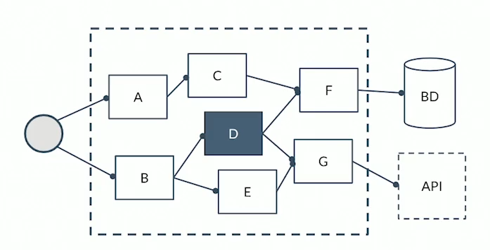
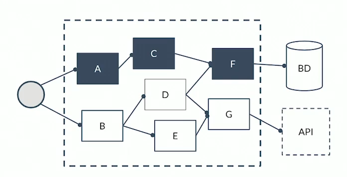
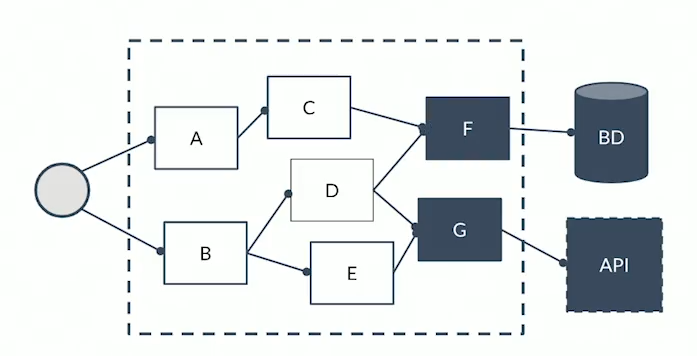
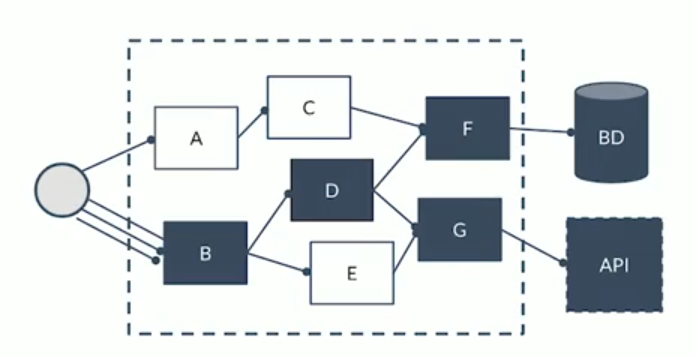
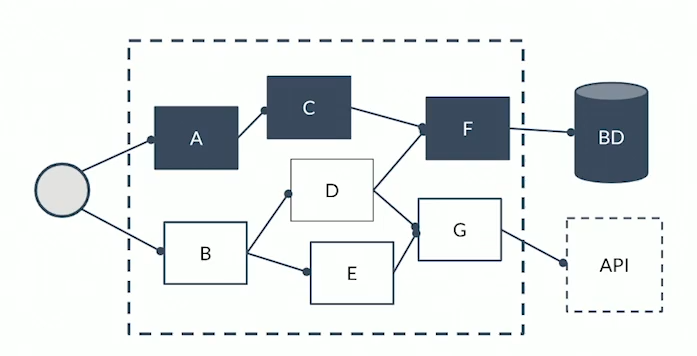
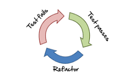

# Testing

### Índice

- [Definición](#definición)
- [Tipos de tests](#test-unitarios)
  - [Test unitarios](#test-unitarios)
  - [Test funcionales](#test-funcionales)
  - [Test de integración](#test-de-integración)
  - [Test de estrés](#test-de-estrés)
  - [Test end to end](#test-end-to-end)
- [TDD (Test Driven Development)](#tdd-test-driven-development)
  - [Reglas del TDD](#reglas-del-tdd)

## Definición:
Los tests en el desarrollo de software son porciones de código que
prueban nuestro código. Existen varios tipos de tests:

### Tests unitarios:
Son para probar un componente específico de la aplicación.
  

### Tests funcionales:
Son para probar una funcionalidad completa de la aplicación.

### Tests de integración:
Son para probar si la integración de la
aplicación con componentes externos funciona correctamente, por ejemplo,
integración con APIs, bases de datos, entre otros.

### Tests de estrés:
Son para probar el comportamiento de la aplicación
cuando una gran cantidad de usuarios hacen uso de ella, por ejemplo
probar cómo se comporta un API cuando recibe muchas solicitudes.

### Tests end to end:
Pruebas completas de un sistema, de inicio a fin.

## TDD (Test Driven Development)
Desarrollo guiado por tests. Se trata de una técnica de desarrollo de
software en el que primero creamos los tests y luego creamos el código
de la aplicación que hace que pasen estos tests. Esto con el fin de
garantizar que nuestra aplicación realice lo que debe hacer.

El TDD se basa en el ciclo Red-Green-Refactor:

- Red: Se escribe una prueba que falle.
  
- Green: Se implementa el código necesario para que la prueba pase.
  
- Refactor: Se revisa el código para mejorar su calidad.

### Reglas del TDD:

- Solo escribirás código de test hasta que falle.
  
- Solo escribirás código de producción si es para pasar un test que falla.
  
- No escribirás más código del necesario para hacer pasar el test.
